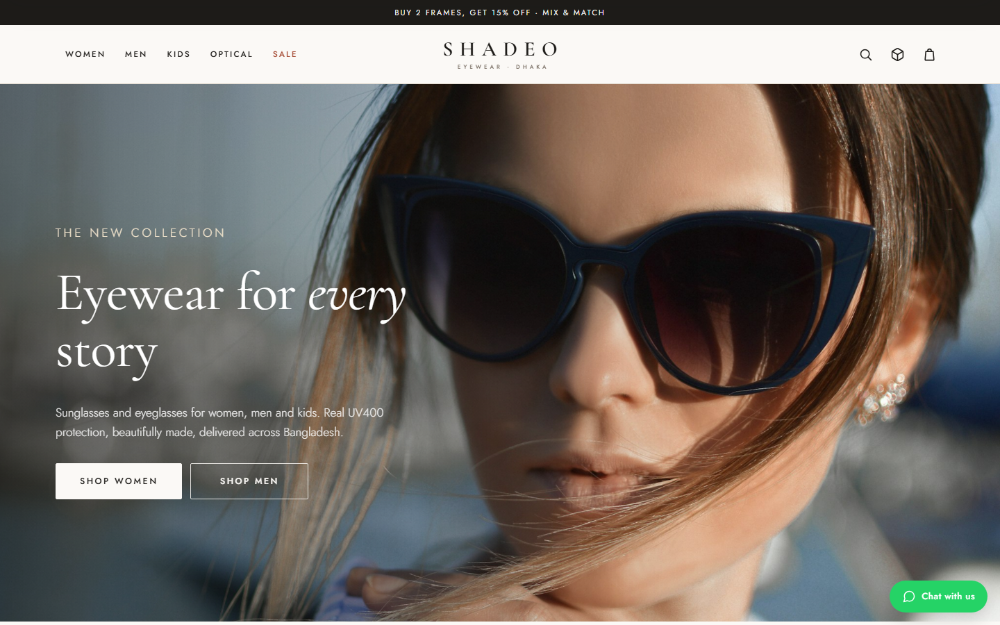
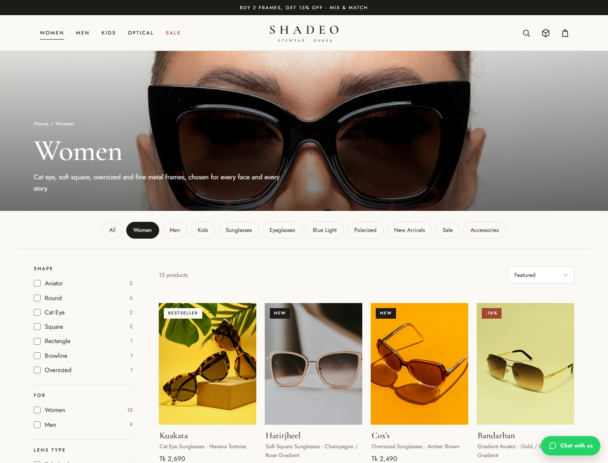
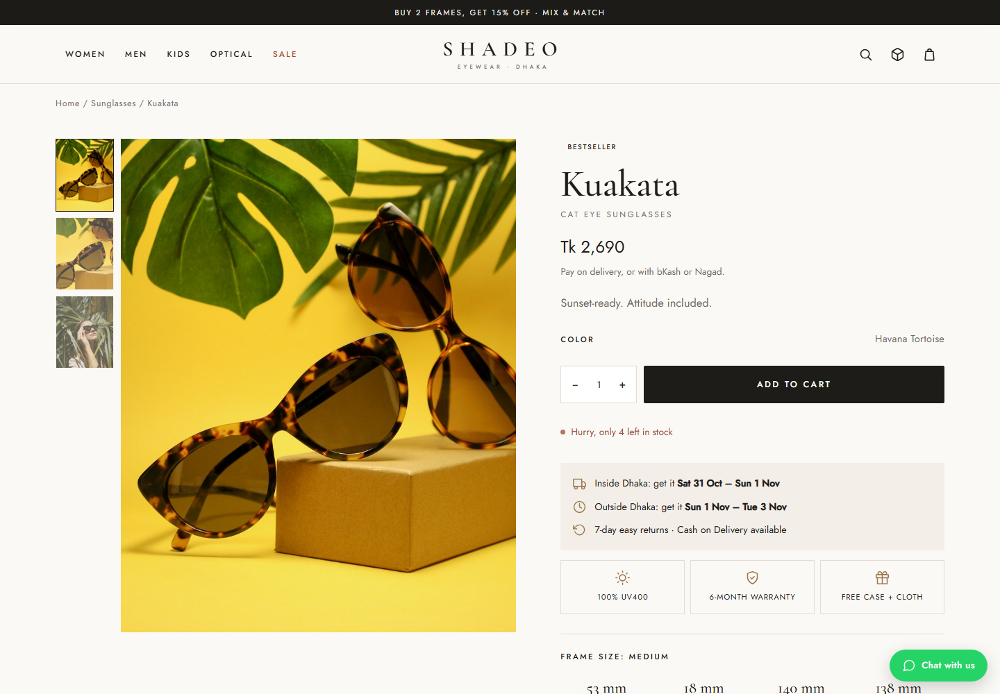
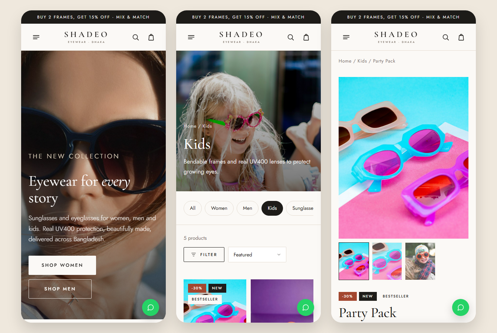

<div align="center">

# SHADEO

**Premium eyewear for women, men and kids, designed in Dhaka.**

A complete e-commerce storefront for a Bangladeshi sunglasses and eyeglasses brand, with prescription lenses, Cash on Delivery and WhatsApp ordering. Includes a matching Shopify theme kit and launch-ready business docs.

[](https://glass-store-murex.vercel.app)
[](https://glass-store-murex.vercel.app)


<br>



</div>

---

## Contents

- [Overview](#overview)
- [Features](#features)
- [Screenshots](#screenshots)
- [Tech stack](#tech-stack)
- [Project structure](#project-structure)
- [Getting started](#getting-started)
- [Configuration](#configuration)
- [Deployment](#deployment)
- [Shopify theme kit](#shopify-theme-kit)
- [Business docs](#business-docs)
- [Image credits](#image-credits)
- [Roadmap](#roadmap)

## Overview

SHADEO is a storefront built for the Bangladeshi market:

- Prices in **Taka (BDT)**, with **Cash on Delivery**, **bKash** and **Nagad**
- Inside-Dhaka and outside-Dhaka delivery rates, with free delivery over Tk 3,000
- Delivery estimates that skip **Friday**, the local weekend
- Orders confirmed over **WhatsApp**, the way most local shoppers prefer to buy

The site is plain HTML, CSS and JavaScript, with no framework and no build step. It runs from any static host and works when opened straight from your computer.

## Features

**Shopping**
- Collections for Women, Men, Kids, Optical, Polarized, Blue Light, New, Sale and Accessories
- Filters by shape, gender, lens type, frame material, price and stock, plus sorting and live search
- Product pages with a photo gallery, close-up zoom, frame measurements and a size-guide pop-up
- **Lens selector**: non-prescription, blue-light, single vision, or sun-tint lenses, with live pricing
- **Prescription form** (SPH, CYL, AXIS, PD) with validation, or "send a photo on WhatsApp"
- Low-stock badges and a sticky add-to-cart bar on mobile

**Cart and checkout**
- Slide-out bag with a free-delivery progress bar and an accessory upsell
- Automatic "Buy 2 frames, get 15% off" and discount codes (the bigger discount wins)
- Checkout with delivery area, Cash on Delivery, bKash or Nagad (transaction ID), and order notes
- Order confirmation that sends the full order to the shop on WhatsApp in one tap
- Order tracking page

**Engagement**
- 60-second frame-finder quiz with scored product picks
- Face-shape guide, prescription guide and journal articles
- Welcome pop-up with a first-order code, newsletter signup and a floating WhatsApp button

**Design**
- "Clean luxury" look: ivory and sand palette, Cormorant Garamond and Jost typography
- Fully responsive, from 360 px phones to wide desktops
- Accessible: semantic HTML, keyboard-friendly menus and dialogs, reduced-motion support

## Screenshots

| Collection page | Product page |
|---|---|
|  |  |

<p align="center"></p>

## Tech stack

| Area | Choice |
|---|---|
| Markup and styles | HTML5, modern CSS (grid, `:has()`, custom properties) |
| Behaviour | Vanilla JavaScript (ES2017+), no dependencies |
| Data | `website/assets/js/data.js`: products, lenses, prices and store settings |
| Storage | `localStorage` for the cart and orders on the shopper's device |
| Hosting | Vercel (static), auto-deployed from `main` |
| Shopify kit | Liquid sections and snippets for the free Dawn theme |

## Project structure

```text
.
├── website/                  # The live storefront (deployed to Vercel)
│   ├── index.html            # Homepage
│   ├── shop.html             # Collections: ?c=women | men | kids | eyeglasses | sale …
│   ├── product.html          # Product page: ?p=<product-handle>
│   ├── checkout.html         # Checkout + order confirmation
│   ├── quiz.html, track-order.html, about.html, faq.html, …
│   └── assets/
│       ├── css/style.css     # Design system and all page styles
│       ├── img/              # Product, lifestyle and banner photos
│       └── js/
│           ├── data.js       # Catalog, lens prices, delivery and contact settings
│           ├── app.js        # Header, footer, cart, search, pop-ups (every page)
│           ├── frames.js     # Line icons and frame-shape drawings
│           └── pages/        # Page logic: home, shop, product, checkout, quiz
├── shopify-theme/            # Custom sections and snippets for Shopify's Dawn theme
├── content/                  # Store copy, policies, SEO, brand guide, launch plans
├── docs/screenshots/         # Images used in this README
├── 01-THEME-SETUP.md         # Step-by-step Shopify setup guide
├── CHANGELOG.md
└── vercel.json               # Serves the website/ folder
```

## Getting started

**Quickest:** open `website/index.html` in your browser. Nothing to install.

**With a local server** (closer to how it runs online):

```bash
git clone https://github.com/mahmudultopu/glass-store.git
cd glass-store
npx serve website
```

Then open the address it prints, usually http://localhost:3000.

## Configuration

Everything you'll want to change lives in [`website/assets/js/data.js`](website/assets/js/data.js):

| Setting | What it does |
|---|---|
| `whatsapp` | The number orders and chats are sent to (digits only, e.g. `8801712345678`) |
| `phone`, `email`, `address`, social links | Contact details shown across the site |
| `shipping`, `freeShippingOver` | Delivery charges and the free-delivery threshold |
| `bundle`, `codes` | "Buy 2" discount and promo codes |
| `deliveryDays`, `cutoffHour` | Delivery estimates and same-day cut-off |
| `SHADEO_LENSES` | Lens options and prices |
| `SHADEO_PRODUCTS` | The catalog |

**Adding a product:** put a photo in `website/assets/img/products/` (portrait 4:5 works best), then add an entry to `SHADEO_PRODUCTS`:

```js
{
  handle: 'bogura-round', name: 'Bogura', style: 'Round Sunglasses',
  type: 'Sunglasses', shape: 'round', material: 'acetate',
  tags: ['women', 'men', 'new'],           // drives collections, filters and badges
  price: 2390, compare: 2890, stock: 12,    // compare = original price, shows a sale badge
  colors: [{ name: 'Black / Smoke' }],
  image: IMG + 'products/bogura-round.jpg',
  size: [50, 20, 145, 136], fit: 'Medium', weight: 20,
  tagline: 'One line that sells the frame.',
  description: 'A short paragraph about the frame.',
  features: ['100% UV400 lenses', 'Hand-polished acetate'],
}
```

Add `'lens-selector'` to `tags` to offer prescription lenses on that frame.

## Deployment

The site is connected to Vercel: **every push to `main` deploys automatically** to https://glass-store-murex.vercel.app. [`vercel.json`](vercel.json) tells Vercel to serve the `website/` folder with no build step.

To deploy anywhere else (Netlify, Cloudflare Pages, GitHub Pages), publish the `website/` folder as-is.

## Shopify theme kit

When the business moves to Shopify, [`shopify-theme/`](shopify-theme/) adds the same features to Shopify's free Dawn theme: shape carousel, lens selector with prescription entry, frame specs and size guide, delivery estimates, sticky add-to-cart, free-shipping bar, cart upsell, product badges and a WhatsApp button.

Setup instructions: [`01-THEME-SETUP.md`](01-THEME-SETUP.md).

## Business docs

| Doc | Contents |
|---|---|
| [Apps](content/02-APPS.md) | Recommended Shopify apps with free alternatives |
| [Website copy](content/03-WEBSITE-COPY.md) | Homepage, product descriptions, About, FAQ, guides |
| [Collections and tags](content/04-COLLECTIONS-TAGS-METAFIELDS.md) | Catalog structure, metafields and filters |
| [Emails and pop-ups](content/05-EMAILS-POPUPS-ANNOUNCEMENTS.md) | Announcements, welcome and abandoned-cart emails |
| [Policies](content/06-POLICIES.md) | Shipping, returns, warranty, privacy, terms |
| [SEO](content/07-SEO.md) | Titles, meta descriptions, keywords in English and Bangla |
| [Brand guide](content/08-BRAND-GUIDE.md) | Logo concepts, taglines, colours, fonts, photo style |
| [Launch checklist](content/10-LAUNCH-CHECKLIST.md) | Everything to test before going live |
| [30-day marketing plan](content/11-30-DAY-MARKETING-PLAN.md) | Day-by-day plan to the first 100 orders |

## Image credits

Product, lifestyle and banner photos are from [Unsplash](https://unsplash.com) and are used under the [Unsplash License](https://unsplash.com/license), which allows free commercial use. They show the style of the range. Before running ads, replace product photos with photos of the actual frames being sold.

## Roadmap

- [ ] Real product photography of the SHADEO range
- [ ] Online payment gateway (SSLCommerz / bKash API)
- [ ] Order database and admin dashboard
- [ ] Bangla language version
- [ ] Customer reviews with photos
- [ ] Move the storefront to Shopify using the included theme kit

---

<div align="center">

Built by [**@mahmudultopu**](https://github.com/mahmudultopu) · SHADEO, Dhaka, Bangladesh

</div>
